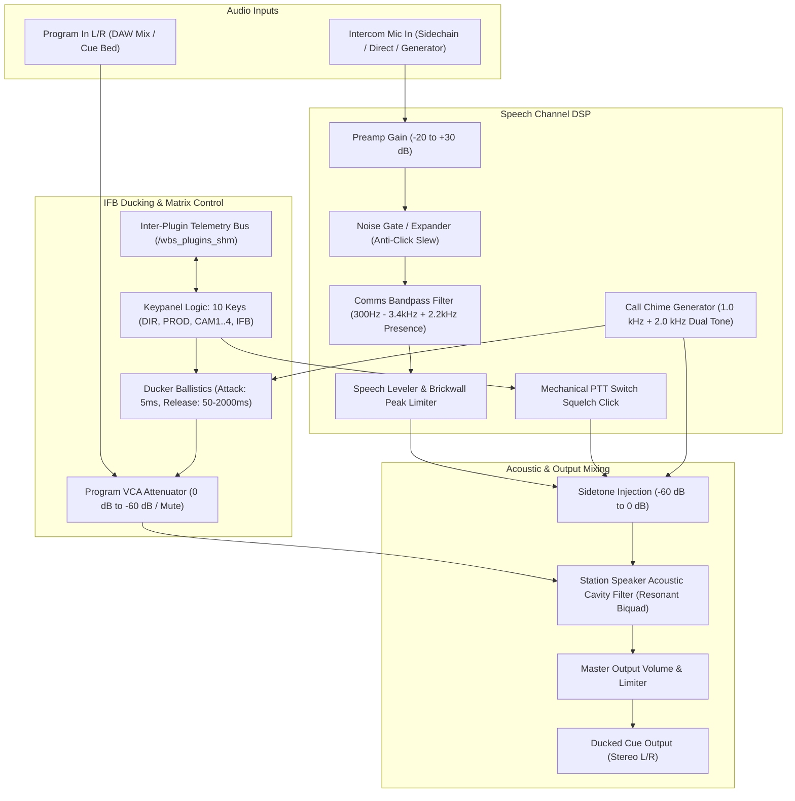

# Ward-Beck Systems M7880 Intercom Panel & IFB Station - VST/CLAP Plugin Build Plan

**Module Name:** WBS M7880 Broadcast Intercom Station & IFB Ducker  
**Hardware Reference:** Ward-Beck Systems MicroCOM II / MicroCOM III Intercom Stations (Models M7880, M7880/81, M7880D, M7882, M7840)  
**Target Architecture:** VST3 / AU / AAX / CLAP / Standalone (C++20 / Native Frame Engine)  
**Shared Engine Dependency:** [`wbs::engine::SharedPluginFrame`](file:///home/anthony/Documents/GitProjects/WBSps.ca/2030.env/vst/core/SharedPluginFrame.hpp), [`wbs::engine::StateVariableFilterCore`](file:///home/anthony/Documents/GitProjects/WBSps.ca/2030.env/vst/core/StateVariableCore.hpp), [`wbs::engine::NonLinearCore`](file:///home/anthony/Documents/GitProjects/WBSps.ca/2030.env/vst/core/NonLinearCore.hpp), [`wbs::telemetry::PluginTelemetryBroker`](file:///home/anthony/Documents/GitProjects/WBSps.ca/2030.env/vst/core/PluginTelemetryShm.hpp)

---

## 1. Hardware Heritage & System Context

During the 1980s and 1990s, Ward-Beck Systems set the standard for broadcast television talkback and intercom infrastructure with the **MicroCOM II** and **MicroCOM III** microprocessor-controlled intercom matrices. Installed in major network broadcast control rooms (CBC, ABC, NBC, CTV) and mobile production trucks across North America, the MicroCOM system linked directors, technical directors, producers, camera operators, sound engineers, and on-air talent.

The physical operator stations were the iconic **M7800-series keypanels**:
- **M7880**: Standard 10-key 2RU station (6 destination keys + 4 function keys A–D).
- **M7880/81**: 20-key station with the M7881 10-key expansion chassis.
- **M7880D**: 16-key station (12 destination keys + 4 function keys A–D).
- **M7880/F**: 36-key 3RU master station with 16 dedicated group/IFB "F" keys.
- **M7840**: Compact 6-key desktop / talent turret station.

Each key on an M7880 station featured:
1. A **4-character red alphanumeric LED readout** displaying the destination mnemonic (e.g. `DIR `, `PROD`, `CAM1`, `CAM2`, `SND `, `IFB1`, `CR1 `, `STU1`, `HOST`, `ALL `).
2. Dual status **Tally LEDs**:
   - **Green LED**: Channel monitored / active listen / incoming ring.
   - **Red LED**: Talk / PTT (Push-To-Talk) transmit active.
3. Heavy-duty black paddle switches with momentary push-to-talk (down) and latching toggle (up).
4. Direct **IFB (Interruptible Foldback)** program audio ducking: when director or producer talkback is keyed, program audio is smoothly attenuated by -20 dB (or muted) to allow clear voice transmission to on-air talent earpieces.

---

## 2. Audio Processing Architecture & DSP Signal Flow

In modern digital audio workstations (DAWs) and broadcast production rigs, the M7880 Intercom Panel plugin serves dual purposes:
1. **Authentic Vintage Broadcast Comms Audio Effect**: Processing vocal tracks with realistic intercom bandpass filtering, carbon mic presence, speech leveling compression, acoustic station speaker cabinet resonance, and authentic mechanical PTT switch clicks.
2. **Production Talkback & IFB Ducker**: Placing on talent monitor cue buses, podcast host tracks, or studio control room feeds where incoming talkback automatically and smoothly ducks the background mix with sample-accurate ballistics.

---

## 3. Mathematical DSP Specifications

### 3.1 Speech Channel Noise Gate & Expander
To eliminate studio HVAC rumble and room bleed when the operator is not actively speaking:
$$g_{gate}[n] = 1.0 - \text{Range} \cdot \frac{1.0}{1.0 + \exp\left(\frac{L_{in}[n] - T_{thresh}}{\sigma}\right)}$$
where $T_{thresh} \in [-70\text{ dBFS}, -20\text{ dBFS}]$, $\text{Range} \in [0.0, 0.99]$ (up to 40 dB downward expansion), and $\sigma = 1.5\text{ dB}$ provides an organic, click-free soft knee.

### 3.2 Broadcast Communications Bandpass Filter
Authentic telephone/intercom voice spectrum:
- **High-Pass Filter**: 300 Hz, 3rd-order (18 dB/oct) Butterworth/Bessel topology to remove low-end pop and chest resonance.
- **Low-Pass Filter**: 3.4 kHz, 3rd-order (18 dB/oct) cutoff eliminating high-frequency hiss.
- **Presence Boost**: $+3.5\text{ dB}$ bell filter peaked at $2.2\text{ kHz}$ ($Q = 1.8$) for cutting through loud stage or OB van ambient noise.

### 3.3 Speech Leveler & Fast Limiter
To keep shouted emergency calls and quiet murmurs at consistent broadcast intelligibility:
$$y[n] = \begin{cases}
x[n] & \text{if } |x[n]| \le L_{thresh} \\
L_{thresh} + \frac{|x[n]| - L_{thresh}}{R_{comp}} & \text{if } L_{thresh} < |x[n]| \le L_{limit} \\
L_{limit} \cdot \tanh\left(\frac{|x[n]|}{L_{limit}}\right) & \text{if } |x[n]| > L_{limit}
\end{cases}$$
with compression ratio $R_{comp} = 4.0$, threshold $-18\text{ dBFS}$, and soft saturation limiting at $-1.0\text{ dBFS}$.

### 3.4 Interruptible Foldback (IFB) Ducking Ballistics
When any Talk key is engaged or Call alert is triggered, Program Audio is ducked by $\text{Depth}_{dB} \in [0, -60\text{ dB}]$ (or full mute):
$$\alpha_{att} = \exp\left(-\frac{1}{f_s \cdot \tau_{att}}\right), \quad \alpha_{rel} = \exp\left(-\frac{1}{f_s \cdot \tau_{rel}}\right)$$
During active talkback:
$$g_{duck}[n] = \alpha_{att} \cdot g_{duck}[n-1] + (1 - \alpha_{att}) \cdot G_{target}$$
During release (after a 100 ms hold hangover):
$$g_{duck}[n] = \alpha_{rel} \cdot g_{duck}[n-1] + (1 - \alpha_{rel}) \cdot 1.0$$

### 3.5 Intercom Speaker Box Acoustic Resonance
Small 3" metal station speaker emulation using a 2nd-order resonant peaking biquad:
- Center frequency: $f_0 = 980\text{ Hz}$
- Quality factor: $Q = 2.4$
- Gain: $+6.0\text{ dB}$
- Combined with a 6 dB/oct high shelf roll-off above $4.5\text{ kHz}$ to mimic metal cavity acoustics.

### 3.6 Call Alert Chime Generator
Dual-tone alert chime synthesizing $1000\text{ Hz}$ and $2000\text{ Hz}$ sinusoids with exponential envelope decay ($\tau = 350\text{ ms}$):
$$s_{call}[n] = e^{-t / \tau} \cdot \left[0.6 \sin(2\pi \cdot 1000 \cdot t) + 0.4 \sin(2\pi \cdot 2000 \cdot t)\right]$$

---

## 4. Front Panel Controls & Parameters

| ID | Parameter Name | Range | Default | Unit | Description |
|---|---|---|---|---|---|
| 0 | Master Volume | -60.0 to +12.0 | 0.0 | dB | Station monitor volume |
| 1 | Mic Gain | -20.0 to +30.0 | 0.0 | dB | Preamp sensitivity |
| 2 | Sidetone Level | -60.0 to 0.0 | -18.0 | dB | Mic feedback in operator headset/speaker |
| 3 | IFB Duck Depth | -60.0 to 0.0 | -20.0 | dB | Program attenuation during talkback (-60 = Mute) |
| 4 | Duck Release | 50.0 to 2000.0 | 350.0 | ms | Program restoration smoothing time |
| 5 | Gate Threshold | -70.0 to -20.0 | -45.0 | dB | Mic noise gate cutoff |
| 6 | Comms EQ Mode | 0 to 2 | 1 | Enum | 0: Flat, 1: Broadcast (150Hz-7.5kHz), 2: Telecom (300Hz-3.4kHz) |
| 7 | Speaker Mode | 0 to 1 | 0 | Enum | 0: Headset (Direct), 1: Station Speaker (Resonant Cab) |
| 8 | Mic Source | 0 to 2 | 2 | Enum | 0: Sidechain Ch 2/3, 1: Main L, 2: Internal Speech Generator |
| 9 | Call Chime | 0 or 1 | 0 | Trig | Trigger 1 kHz/2 kHz broadcast alert chime |
| 10 | Bypass | 0 or 1 | 0 | Bool | Master DSP bypass |
| 11 | PTT Mode | 0 or 1 | 1 | Enum | 0: Momentary Hold, 1: Latch Toggle |
| 12 | Mech Clicks | 0 or 1 | 1 | Bool | Realistic mechanical switch paddle click |
| 13..22 | Key 1..10 Talk | 0 or 1 | 0 | Bool | Talk/Transmit PTT for Key 1..10 |
| 23..32 | Key 1..10 Listen | 0 or 1 | 0 | Bool | Listen/Monitor for Key 1..10 |

---

## 5. Keypanel Stations & Default Mnemonics

| Slot | Key Label | Mnemonic | Full Station Title | Default Route / Role |
|---|---|---|---|---|
| 0 | Key 1 | `DIR ` | Director | Production Director Talkback |
| 1 | Key 2 | `PROD` | Producer | Executive Producer Line |
| 2 | Key 3 | `CAM1` | Camera 1 | Studio Pedestal Camera 1 |
| 3 | Key 4 | `CAM2` | Camera 2 | Studio Jib / Camera 2 |
| 4 | Key 5 | `SND ` | Sound | Audio Control Booth |
| 5 | Key 6 | `IFB1` | Talent IFB | On-Air Anchor In-Ear Cue |
| 6 | Key A | `CR1 ` | Control Room | Master Control Facility |
| 7 | Key B | `STU1` | Studio Floor | Studio Floor Manager |
| 8 | Key C | `HOST` | Anchor Host | Main Desk Guest/Host |
| 9 | Key D | `ALL ` | All Page | General Facility All-Call Ring |
